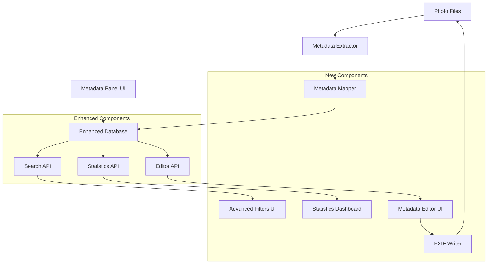

# Design Document

## Overview

The metadata completion system transforms PhotoSearch's existing metadata extraction capabilities into a professional-grade searchable and editable interface. Building on the solid foundation of `src/metadata_extractor.py` and `src/metadata_search.py`, this design adds database schema enhancements, advanced UI components, and write-back capabilities to compete with Adobe Lightroom's metadata features.

The system follows PhotoSearch's "living app" design language with glassmorphism UI elements and maintains the existing modular architecture principle of "one task = one file."

## Architecture

### High-Level Architecture



### Component Interaction Flow

1. **Extraction Flow**: Files → Metadata Extractor → Metadata Mapper → Enhanced Database
2. **Search Flow**: UI → Search API → Enhanced Database → Results
3. **Edit Flow**: Metadata Editor → Editor API → Enhanced Database → EXIF Writer → Files
4. **Display Flow**: Metadata Panel → Enhanced Database → Formatted Display

## Components and Interfaces

### 1. Enhanced Database Schema

**File**: `server/database/metadata_schema_v2.py`

```python
class MetadataSchemaV2:
    """
    Enhanced metadata database schema with searchable columns.
    Extends existing metadata table with structured fields.
    """
    
    SEARCHABLE_COLUMNS = {
        # Camera Information
        'camera_make': 'TEXT',
        'camera_model': 'TEXT', 
        'camera_serial': 'TEXT',
        
        # Lens Information
        'lens_make': 'TEXT',
        'lens_model': 'TEXT',
        'lens_serial': 'TEXT',
        
        # Exposure Settings
        'iso': 'INTEGER',
        'aperture': 'REAL',  # f-number (e.g., 2.8)
        'shutter_speed': 'TEXT',  # display format (e.g., "1/250")
        'shutter_speed_decimal': 'REAL',  # for range queries
        'exposure_compensation': 'REAL',
        'exposure_mode': 'TEXT',
        'metering_mode': 'TEXT',
        
        # Focal Length
        'focal_length': 'REAL',  # in mm
        'focal_length_35mm': 'INTEGER',  # 35mm equivalent
        
        # Flash
        'flash_used': 'BOOLEAN',
        'flash_mode': 'TEXT',
        
        # White Balance
        'white_balance': 'TEXT',
        'color_temperature': 'INTEGER',
        
        # Image Quality
        'image_quality': 'TEXT',  # RAW, JPEG, etc.
        'color_space': 'TEXT',  # sRGB, AdobeRGB, etc.
        'bit_depth': 'INTEGER',
        
        # Software
        'software': 'TEXT',
        'edit_software': 'TEXT',
        
        # Copyright & Attribution
        'copyright': 'TEXT',
        'creator': 'TEXT',
        'creator_tool': 'TEXT',
        
        # Composite Fields
        'exposure_triangle': 'TEXT',  # "ISO 400, f/2.8, 1/250"
        'searchable_text': 'TEXT'  # Full-text search index
    }
```

**Migration Strategy**:
- Add new columns to existing `metadata` table
- Populate columns from existing JSON metadata
- Create indexes on searchable columns
- Maintain backward compatibility

### 2. Metadata Mapper

**File**: `server/metadata/metadata_mapper.py`

```python
class MetadataMapper:
    """
    Maps raw EXIF/metadata to structured database columns.
    Handles normalization, unit conversion, and composite field generation.
    """
    
    def __init__(self):
        self.camera_normalizer = CameraNormalizer()
        self.lens_normalizer = LensNormalizer()
    
    def map_camera_metadata(self, raw_metadata: Dict[str, Any]) -> Dict[str, Any]:
        """
        Extract and normalize camera-specific fields from raw metadata.
        
        Args:
            raw_metadata: Raw metadata from metadata_extractor
            
        Returns:
            Dictionary of normalized searchable fields
        """
        exif = raw_metadata.get('exif', {})
        image_exif = exif.get('image', {})
        
        return {
            'camera_make': self.camera_normalizer.normalize_make(
                image_exif.get('Make', '')
            ),
            'camera_model': self.camera_normalizer.normalize_model(
                image_exif.get('Model', '')
            ),
            'lens_model': self.lens_normalizer.normalize_model(
                exif.get('LensModel', '')
            ),
            'iso': self._parse_iso(exif.get('ISOSpeedRatings')),
            'aperture': self._parse_aperture(exif.get('FNumber')),
            'shutter_speed': self._format_shutter_speed(exif.get('ExposureTime')),
            'shutter_speed_decimal': self._parse_shutter_decimal(exif.get('ExposureTime')),
            'focal_length': self._parse_focal_length(exif.get('FocalLength')),
            'exposure_triangle': self._build_exposure_triangle(
                iso, aperture, shutter_speed
            )
        }
    
    def _parse_shutter_speed(self, exposure_time: str) -> Tuple[str, float]:
        """Convert EXIF exposure time to display format and decimal."""
        # Implementation handles formats like "1/250", "0.004", etc.
        pass
    
    def _build_exposure_triangle(self, iso: int, aperture: float, shutter: str) -> str:
        """Create human-readable exposure summary."""
        return f"ISO {iso}, f/{aperture}, {shutter}"
```

### 3. Search API Enhancement

**File**: `server/api/routers/metadata.py`

```python
from fastapi import APIRouter, Query, Depends
from typing import List, Optional
from server.metadata.search_service import MetadataSearchService

router = APIRouter(prefix="/api/metadata", tags=["metadata"])

@router.get("/fields")
async def get_available_fields(
    search_service: MetadataSearchService = Depends()
):
    """
    Get list of all searchable metadata fields with value counts.
    
    Returns:
        {
            "camera_make": {"Canon": 5000, "Nikon": 3000, "Sony": 2000},
            "iso": {"100": 500, "200": 800, "400": 1200},
            "aperture": {"1.4": 200, "2.8": 800, "4.0": 600}
        }
    """
    return await search_service.get_field_statistics()

@router.get("/fields/{field_name}/values")
async def get_field_values(
    field_name: str,
    query: Optional[str] = None,
    limit: int = 50,
    search_service: MetadataSearchService = Depends()
):
    """
    Get autocomplete suggestions for a specific field.
    
    Example: /api/metadata/fields/camera_make/values?query=can
    Returns: ["Canon", "Canon EOS"]
    """
    return await search_service.get_field_autocomplete(field_name, query, limit)

@router.get("/search")
async def search_by_metadata(
    camera_make: Optional[str] = None,
    camera_model: Optional[str] = None,
    iso_min: Optional[int] = None,
    iso_max: Optional[int] = None,
    aperture_min: Optional[float] = None,
    aperture_max: Optional[float] = None,
    focal_length_min: Optional[int] = None,
    focal_length_max: Optional[int] = None,
    lens_model: Optional[str] = None,
    limit: int = 100,
    offset: int = 0,
    search_service: MetadataSearchService = Depends()
):
    """
    Search photos by metadata fields with range and exact match support.
    """
    filters = MetadataFilters(
        camera_make=camera_make,
        camera_model=camera_model,
        iso_range=(iso_min, iso_max) if iso_min or iso_max else None,
        aperture_range=(aperture_min, aperture_max) if aperture_min or aperture_max else None,
        focal_length_range=(focal_length_min, focal_length_max) if focal_length_min or focal_length_max else None,
        lens_model=lens_model
    )
    
    return await search_service.search_by_filters(filters, limit, offset)

@router.get("/stats")
async def get_metadata_stats(
    search_service: MetadataSearchService = Depends()
):
    """
    Get aggregate statistics about photo metadata for dashboard.
    """
    return await search_service.get_library_statistics()
```

### 4. Advanced Filters UI Component

**File**: `ui/src/components/metadata/AdvancedFilters.tsx`

```tsx
import React, { useState, useEffect } from 'react';
import { Camera, Aperture, Settings, Search } from 'lucide-react';
import { AutocompleteField } from './AutocompleteField';
import { RangeSlider } from './RangeSlider';
import { metadataApi } from '../../api/metadata';

interface MetadataFilters {
  camera_make?: string;
  camera_model?: string;
  lens_model?: string;
  iso_min?: number;
  iso_max?: number;
  aperture_min?: number;
  aperture_max?: number;
  focal_length_min?: number;
  focal_length_max?: number;
}

interface AdvancedFiltersProps {
  onFiltersChange: (filters: MetadataFilters) => void;
  initialFilters?: MetadataFilters;
}

export const AdvancedFilters: React.FC<AdvancedFiltersProps> = ({
  onFiltersChange,
  initialFilters = {}
}) => {
  const [filters, setFilters] = useState<MetadataFilters>(initialFilters);
  const [isExpanded, setIsExpanded] = useState(false);

  const updateFilter = (key: keyof MetadataFilters, value: any) => {
    const newFilters = { ...filters, [key]: value };
    setFilters(newFilters);
    onFiltersChange(newFilters);
  };

  return (
    <div className="advanced-filters glassmorphism rounded-lg p-4 space-y-4">
      <div className="flex items-center justify-between">
        <h3 className="text-lg font-semibold flex items-center gap-2">
          <Settings className="w-5 h-5" />
          Advanced Filters
        </h3>
        <button
          onClick={() => setIsExpanded(!isExpanded)}
          className="text-sm text-blue-400 hover:text-blue-300"
        >
          {isExpanded ? 'Collapse' : 'Expand'}
        </button>
      </div>

      {isExpanded && (
        <div className="space-y-4">
          {/* Camera Section */}
          <div className="space-y-3">
            <h4 className="text-sm font-medium flex items-center gap-2">
              <Camera className="w-4 h-4" />
              Camera
            </h4>
            
            <AutocompleteField
              label="Make"
              field="camera_make"
              value={filters.camera_make}
              onChange={(value) => updateFilter('camera_make', value)}
              placeholder="Canon, Nikon, Sony..."
            />
            
            <AutocompleteField
              label="Model"
              field="camera_model"
              value={filters.camera_model}
              onChange={(value) => updateFilter('camera_model', value)}
              placeholder="EOS R5, D850, A7R IV..."
            />
          </div>

          {/* Exposure Section */}
          <div className="space-y-3">
            <h4 className="text-sm font-medium flex items-center gap-2">
              <Settings className="w-4 h-4" />
              Exposure
            </h4>
            
            <RangeSlider
              label="ISO"
              min={100}
              max={12800}
              step={100}
              values={[filters.iso_min ?? 100, filters.iso_max ?? 12800]}
              onChange={([min, max]) => {
                updateFilter('iso_min', min);
                updateFilter('iso_max', max);
              }}
              formatValue={(value) => `ISO ${value}`}
            />
            
            <RangeSlider
              label="Aperture"
              min={1.4}
              max={22}
              step={0.1}
              values={[filters.aperture_min ?? 1.4, filters.aperture_max ?? 22]}
              onChange={([min, max]) => {
                updateFilter('aperture_min', min);
                updateFilter('aperture_max', max);
              }}
              formatValue={(value) => `f/${value}`}
            />
          </div>

          {/* Lens Section */}
          <div className="space-y-3">
            <h4 className="text-sm font-medium flex items-center gap-2">
              <Aperture className="w-4 h-4" />
              Lens
            </h4>
            
            <RangeSlider
              label="Focal Length"
              min={10}
              max={600}
              step={1}
              values={[filters.focal_length_min ?? 10, filters.focal_length_max ?? 600]}
              onChange={([min, max]) => {
                updateFilter('focal_length_min', min);
                updateFilter('focal_length_max', max);
              }}
              formatValue={(value) => `${value}mm`}
            />
            
            <AutocompleteField
              label="Lens Model"
              field="lens_model"
              value={filters.lens_model}
              onChange={(value) => updateFilter('lens_model', value)}
              placeholder="24-70mm f/2.8, 85mm f/1.4..."
            />
          </div>

          {/* Action Buttons */}
          <div className="flex gap-2 pt-2">
            <button
              onClick={() => {
                setFilters({});
                onFiltersChange({});
              }}
              className="px-3 py-2 text-sm bg-gray-600 hover:bg-gray-500 rounded-md transition-colors"
            >
              Clear All
            </button>
          </div>
        </div>
      )}
    </div>
  );
};
```

### 5. Metadata Panel Component

**File**: `ui/src/components/metadata/MetadataPanel.tsx`

```tsx
import React from 'react';
import { Camera, Aperture, Settings, MapPin, Calendar, Copy } from 'lucide-react';
import { PhotoMetadata } from '../../types/metadata';

interface MetadataPanelProps {
  photoPath: string;
  metadata: PhotoMetadata;
  className?: string;
}

interface MetadataSectionProps {
  title: string;
  icon: React.ReactNode;
  fields: Array<{
    label: string;
    value: string | number | null;
    copyable?: boolean;
  }>;
}

const MetadataSection: React.FC<MetadataSectionProps> = ({ title, icon, fields }) => {
  const copyToClipboard = (value: string) => {
    navigator.clipboard.writeText(value);
    // Show toast notification
  };

  return (
    <div className="metadata-section space-y-2">
      <h4 className="text-sm font-medium flex items-center gap-2 text-gray-300">
        {icon}
        {title}
      </h4>
      <div className="space-y-1">
        {fields.map(({ label, value, copyable = false }, index) => (
          <div key={index} className="flex justify-between items-center text-sm">
            <span className="text-gray-400">{label}</span>
            <div className="flex items-center gap-1">
              <span className="text-white">
                {value || 'N/A'}
              </span>
              {copyable && value && (
                <button
                  onClick={() => copyToClipboard(String(value))}
                  className="p-1 hover:bg-gray-700 rounded transition-colors"
                >
                  <Copy className="w-3 h-3" />
                </button>
              )}
            </div>
          </div>
        ))}
      </div>
    </div>
  );
};

export const MetadataPanel: React.FC<MetadataPanelProps> = ({
  photoPath,
  metadata,
  className = ''
}) => {
  return (
    <div className={`metadata-panel glassmorphism rounded-lg p-4 space-y-6 ${className}`}>
      <div className="flex items-center justify-between">
        <h3 className="text-lg font-semibold">Technical Info</h3>
      </div>

      {/* Camera Section */}
      <MetadataSection
        title="Camera"
        icon={<Camera className="w-4 h-4" />}
        fields={[
          { label: "Make", value: metadata.camera_make },
          { label: "Model", value: metadata.camera_model },
          { label: "Serial", value: metadata.camera_serial, copyable: true },
        ]}
      />

      {/* Exposure Triangle */}
      <MetadataSection
        title="Exposure"
        icon={<Settings className="w-4 h-4" />}
        fields={[
          { label: "ISO", value: metadata.iso },
          { label: "Aperture", value: metadata.aperture ? `f/${metadata.aperture}` : null },
          { label: "Shutter", value: metadata.shutter_speed },
          { label: "Exposure Comp", value: metadata.exposure_compensation ? `${metadata.exposure_compensation} EV` : null },
          { label: "Mode", value: metadata.exposure_mode },
          { label: "Metering", value: metadata.metering_mode },
        ]}
      />

      {/* Lens Section */}
      <MetadataSection
        title="Lens"
        icon={<Aperture className="w-4 h-4" />}
        fields={[
          { label: "Model", value: metadata.lens_model },
          { label: "Focal Length", value: metadata.focal_length ? `${metadata.focal_length}mm` : null },
          { label: "35mm Equiv", value: metadata.focal_length_35mm ? `${metadata.focal_length_35mm}mm` : null },
        ]}
      />

      {/* Location Section */}
      {(metadata.gps_latitude || metadata.gps_longitude) && (
        <MetadataSection
          title="Location"
          icon={<MapPin className="w-4 h-4" />}
          fields={[
            { label: "Latitude", value: metadata.gps_latitude?.toFixed(6), copyable: true },
            { label: "Longitude", value: metadata.gps_longitude?.toFixed(6), copyable: true },
            { label: "Altitude", value: metadata.gps_altitude ? `${metadata.gps_altitude}m` : null },
          ]}
        />
      )}

      {/* File Info Section */}
      <MetadataSection
        title="File Info"
        icon={<Calendar className="w-4 h-4" />}
        fields={[
          { label: "Format", value: metadata.image_format },
          { label: "Dimensions", value: metadata.width && metadata.height ? `${metadata.width} × ${metadata.height}` : null },
          { label: "File Size", value: metadata.file_size_human },
          { label: "Created", value: metadata.date_created },
          { label: "Modified", value: metadata.date_modified },
        ]}
      />

      {/* Copyright Section */}
      {(metadata.copyright || metadata.creator) && (
        <MetadataSection
          title="Copyright"
          icon={<Calendar className="w-4 h-4" />}
          fields={[
            { label: "Copyright", value: metadata.copyright, copyable: true },
            { label: "Creator", value: metadata.creator, copyable: true },
            { label: "Software", value: metadata.software },
          ]}
        />
      )}
    </div>
  );
};
```

## Data Models

### Database Schema

```sql
-- Enhanced metadata table with searchable columns
CREATE TABLE metadata_enhanced (
    id INTEGER PRIMARY KEY AUTOINCREMENT,
    file_path TEXT UNIQUE NOT NULL,
    file_hash TEXT NOT NULL,
    
    -- Camera Information
    camera_make TEXT,
    camera_model TEXT,
    camera_serial TEXT,
    
    -- Lens Information  
    lens_make TEXT,
    lens_model TEXT,
    lens_serial TEXT,
    
    -- Exposure Settings
    iso INTEGER,
    aperture REAL,
    shutter_speed TEXT,
    shutter_speed_decimal REAL,
    exposure_compensation REAL,
    exposure_mode TEXT,
    metering_mode TEXT,
    
    -- Focal Length
    focal_length REAL,
    focal_length_35mm INTEGER,
    
    -- Flash
    flash_used BOOLEAN,
    flash_mode TEXT,
    
    -- White Balance
    white_balance TEXT,
    color_temperature INTEGER,
    
    -- Image Quality
    image_quality TEXT,
    color_space TEXT,
    bit_depth INTEGER,
    
    -- Software
    software TEXT,
    edit_software TEXT,
    
    -- Copyright & Attribution
    copyright TEXT,
    creator TEXT,
    creator_tool TEXT,
    
    -- Composite Fields
    exposure_triangle TEXT,
    searchable_text TEXT,
    
    -- Timestamps
    extracted_at TIMESTAMP DEFAULT CURRENT_TIMESTAMP,
    updated_at TIMESTAMP DEFAULT CURRENT_TIMESTAMP,
    
    -- Foreign key to original metadata
    metadata_id INTEGER REFERENCES metadata(id)
);

-- Indexes for performance
CREATE INDEX idx_metadata_enhanced_camera_make ON metadata_enhanced(camera_make);
CREATE INDEX idx_metadata_enhanced_camera_model ON metadata_enhanced(camera_model);
CREATE INDEX idx_metadata_enhanced_lens_model ON metadata_enhanced(lens_model);
CREATE INDEX idx_metadata_enhanced_iso ON metadata_enhanced(iso);
CREATE INDEX idx_metadata_enhanced_aperture ON metadata_enhanced(aperture);
CREATE INDEX idx_metadata_enhanced_focal_length ON metadata_enhanced(focal_length);
CREATE INDEX idx_metadata_enhanced_searchable_text ON metadata_enhanced(searchable_text);
```

### TypeScript Interfaces

```typescript
// ui/src/types/metadata.ts
export interface PhotoMetadata {
  // Camera Information
  camera_make?: string;
  camera_model?: string;
  camera_serial?: string;
  
  // Lens Information
  lens_make?: string;
  lens_model?: string;
  lens_serial?: string;
  
  // Exposure Settings
  iso?: number;
  aperture?: number;
  shutter_speed?: string;
  shutter_speed_decimal?: number;
  exposure_compensation?: number;
  exposure_mode?: string;
  metering_mode?: string;
  
  // Focal Length
  focal_length?: number;
  focal_length_35mm?: number;
  
  // Flash
  flash_used?: boolean;
  flash_mode?: string;
  
  // White Balance
  white_balance?: string;
  color_temperature?: number;
  
  // Image Quality
  image_quality?: string;
  color_space?: string;
  bit_depth?: number;
  
  // Software
  software?: string;
  edit_software?: string;
  
  // Copyright & Attribution
  copyright?: string;
  creator?: string;
  creator_tool?: string;
  
  // File Information
  file_path: string;
  file_size_bytes?: number;
  file_size_human?: string;
  width?: number;
  height?: number;
  image_format?: string;
  date_created?: string;
  date_modified?: string;
  
  // GPS Information
  gps_latitude?: number;
  gps_longitude?: number;
  gps_altitude?: number;
  
  // Composite Fields
  exposure_triangle?: string;
}

export interface MetadataFilters {
  camera_make?: string;
  camera_model?: string;
  lens_model?: string;
  iso_min?: number;
  iso_max?: number;
  aperture_min?: number;
  aperture_max?: number;
  focal_length_min?: number;
  focal_length_max?: number;
}

export interface MetadataStats {
  total_photos: number;
  cameras: Record<string, number>;
  lenses: Record<string, number>;
  iso_distribution: Record<string, number>;
  aperture_distribution: Record<string, number>;
  focal_length_distribution: Record<string, number>;
  most_common_iso: number;
  most_common_aperture: number;
  most_used_camera: string;
  most_used_lens: string;
}
```

## Correctness Properties

*A property is a characteristic or behavior that should hold true across all valid executions of a system-essentially, a formal statement about what the system should do. Properties serve as the bridge between human-readable specifications and machine-verifiable correctness guarantees.*

### Property 1: Camera Data Normalization
*For any* raw metadata containing camera make information, the normalized camera make stored in the database should follow consistent formatting (e.g., "Canon" not "CANON" or "canon")
**Validates: Requirements 1.1**

### Property 2: Exposure Data Storage Integrity
*For any* photo with EXIF exposure data, the ISO, aperture, and shutter speed values stored in database columns should match the original EXIF values with correct data types
**Validates: Requirements 1.2**

### Property 3: Lens Information Preservation
*For any* photo with lens metadata, the lens make, model, and focal length stored in searchable fields should accurately represent the original lens data
**Validates: Requirements 1.3**

### Property 4: Exposure Triangle Calculation
*For any* photo with ISO, aperture, and shutter speed values, the calculated exposure triangle string should correctly format and combine these values (e.g., "ISO 400, f/2.8, 1/250")
**Validates: Requirements 1.4**

### Property 5: Migration Data Preservation
*For any* existing photo metadata before migration, all metadata fields should be preserved and accessible after migration to the enhanced schema
**Validates: Requirements 1.5, 1.6**

### Property 6: Range Query Functionality
*For any* numeric metadata field (ISO, aperture, focal length), range queries should return only photos with values within the specified range
**Validates: Requirements 1.7**

### Property 7: Autocomplete Suggestions
*For any* partial text input in camera or lens autocomplete fields, the returned suggestions should contain the input text and be relevant to the field type
**Validates: Requirements 2.1, 2.3**

### Property 8: Filter Combination Logic
*For any* combination of multiple filter criteria, the search results should contain only photos that match ALL applied filters (AND logic)
**Validates: Requirements 2.4**

### Property 9: Search Performance
*For any* metadata search query on libraries up to 50,000 photos, the response time should be less than 200ms
**Validates: Requirements 2.5**

### Property 10: Filter State Persistence
*For any* filter settings applied during a session, navigating away and returning should restore the same filter state
**Validates: Requirements 2.6**

### Property 11: Metadata Display Completeness
*For any* photo with available metadata, the metadata panel should display all relevant fields in their appropriate sections (camera, exposure, lens, location, file info, copyright)
**Validates: Requirements 3.1, 3.2, 3.3, 3.4, 3.5, 3.6, 3.7**

### Property 12: Clipboard Copy Functionality
*For any* copyable metadata field, clicking the copy button should successfully copy the field value to the system clipboard
**Validates: Requirements 3.8**

### Property 13: Statistics Data Accuracy
*For any* photo library, the statistics dashboard should display accurate aggregated data including camera distribution, ISO usage, focal length distribution, and library totals
**Validates: Requirements 4.1, 4.2, 4.3, 4.4, 4.6**

### Property 14: Temporal Statistics Filtering
*For any* date range filter applied to statistics, the displayed data should only include photos captured within that date range
**Validates: Requirements 4.7**

### Property 15: Bulk Metadata Updates
*For any* set of selected photos and metadata changes, bulk editing should apply the changes to all selected photos while preserving existing metadata not being modified
**Validates: Requirements 5.1, 5.2, 5.3, 5.4, 5.5**

### Property 16: Metadata Validation
*For any* metadata input in the editor, invalid data should be rejected with appropriate error messages before being applied to photos
**Validates: Requirements 5.6**

### Property 17: EXIF Write-Back Accuracy
*For any* metadata field written back to EXIF (copyright, creator, keywords), the EXIF tag should contain the exact value that was written
**Validates: Requirements 6.1, 6.2, 6.3**

### Property 18: File Backup Creation
*For any* file being modified by the EXIF writer, a backup copy should be created before any modifications are made
**Validates: Requirements 6.4**

### Property 19: Format Support Consistency
*For any* supported file format (JPEG, TIFF, DNG), EXIF write-back operations should succeed without corrupting the file
**Validates: Requirements 6.5**

### Property 20: Write-Back Error Recovery
*For any* EXIF write operation that fails, the original file should be automatically restored from the backup copy
**Validates: Requirements 6.6**

### Property 21: File Integrity Validation
*For any* file after EXIF write-back, the file should remain valid and readable by standard image viewers and metadata readers
**Validates: Requirements 6.7**

### Property 22: Migration Batch Processing
*For any* large photo library migration, the system should process photos in batches without exceeding memory limits
**Validates: Requirements 7.1**

### Property 23: Migration Progress Reporting
*For any* ongoing migration operation, progress updates should be provided at regular intervals showing completion percentage
**Validates: Requirements 7.3**

### Property 24: Migration Rollback Capability
*For any* migration that fails partway through, the rollback operation should restore the database to its pre-migration state
**Validates: Requirements 7.4**

### Property 25: Migration Data Validation
*For any* completed migration, post-migration validation should confirm that all data was migrated correctly and is accessible
**Validates: Requirements 7.5**

### Property 26: API Response Completeness
*For any* metadata API request, the response should include all requested metadata fields in the correct format
**Validates: Requirements 8.1, 8.2, 8.3, 8.4, 8.5**

### Property 27: API Performance
*For any* typical metadata API query, the response time should be less than 200ms
**Validates: Requirements 8.6**

### Property 28: API Pagination
*For any* large result set from metadata API, pagination should correctly split results and provide navigation metadata
**Validates: Requirements 8.7**

### Property 29: System Performance Scalability
*For any* photo library up to 100,000 photos, metadata search operations should maintain sub-200ms response times
**Validates: Requirements 9.1, 9.2**

### Property 30: Database Index Utilization
*For any* metadata search query, the database should use appropriate indexes to optimize query performance
**Validates: Requirements 9.3**

### Property 31: Migration Throughput
*For any* migration operation, the system should process at least 1,000 photos per minute
**Validates: Requirements 9.4**

### Property 32: UI Responsiveness
*For any* background metadata operation, the user interface should remain responsive and interactive
**Validates: Requirements 9.5**

### Property 33: User Feedback Clarity
*For any* metadata editor operation, clear success or error feedback should be provided to the user
**Validates: Requirements 10.3**

### Property 34: Keyboard Shortcut Functionality
*For any* defined keyboard shortcut for metadata operations, triggering the shortcut should perform the correct action
**Validates: Requirements 10.5**

### Property 35: Contextual Help Availability
*For any* complex metadata field, contextual help should be available and provide relevant information about the field
**Validates: Requirements 10.6**

### Property 36: Responsive Design Adaptation
*For any* screen size within the supported range, the metadata UI components should adapt their layout appropriately
**Validates: Requirements 10.7**

## Error Handling

### Database Errors
- **Connection failures**: Implement connection pooling with retry logic
- **Schema migration errors**: Provide rollback capability and detailed error logging
- **Query timeouts**: Implement query optimization and appropriate timeouts
- **Data integrity violations**: Validate data before insertion and provide meaningful error messages

### File System Errors
- **EXIF write failures**: Automatic backup restoration and error reporting
- **Permission errors**: Clear error messages and fallback to database-only updates
- **Disk space issues**: Pre-flight checks and graceful degradation
- **File corruption**: Integrity validation and backup recovery

### API Errors
- **Rate limiting**: Implement appropriate rate limiting and error responses
- **Invalid parameters**: Input validation with detailed error messages
- **Authentication failures**: Secure error handling without information leakage
- **Service unavailability**: Graceful degradation and retry mechanisms

### UI Error Handling
- **Network failures**: Offline capability and retry mechanisms
- **Invalid user input**: Real-time validation with helpful error messages
- **Component failures**: Error boundaries to prevent application crashes
- **Performance issues**: Loading states and progressive enhancement

## Testing Strategy

### Dual Testing Approach
The system requires both unit testing and property-based testing to ensure comprehensive coverage:

**Unit Tests**: Verify specific examples, edge cases, and error conditions
- Test specific camera make normalization (Canon → Canon, CANON → Canon)
- Test exposure triangle calculation with known values
- Test EXIF write-back with sample files
- Test UI component rendering with mock data
- Test API endpoints with specific request/response pairs

**Property Tests**: Verify universal properties across all inputs
- Test metadata normalization with randomly generated camera makes
- Test range queries with random ISO/aperture/focal length values
- Test bulk editing with random photo selections and metadata changes
- Test migration with randomly generated photo libraries
- Test API responses with random valid inputs

### Property-Based Testing Configuration
- **Minimum 100 iterations** per property test due to randomization
- **Test library**: Use `hypothesis` for Python backend, `fast-check` for TypeScript frontend
- **Tag format**: Each test tagged with **Feature: metadata-completion, Property {number}: {property_text}**
- **Data generators**: Create realistic generators for camera makes, lens models, EXIF values
- **Shrinking**: Ensure failing test cases are minimized to simplest failing example

### Integration Testing
- **End-to-end workflows**: Test complete user journeys from file upload to metadata editing
- **Database integration**: Test with real SQLite database and various data sizes
- **API integration**: Test all API endpoints with realistic data loads
- **UI integration**: Test component interactions and state management

### Performance Testing
- **Load testing**: Test with libraries of 10k, 50k, and 100k photos
- **Stress testing**: Test concurrent operations and high query loads
- **Memory testing**: Verify migration doesn't exceed memory limits
- **Response time testing**: Verify all performance requirements are met

### Compatibility Testing
- **File format testing**: Test EXIF write-back with various image formats
- **Browser testing**: Test UI components across different browsers
- **Database testing**: Test with different SQLite versions and configurations
- **Operating system testing**: Test file operations across platforms