# 🎯 Comprehensive Innovation Plan

**Version:** 2.0 - Updated with Next Steps Integration  
**Date:** 2025-12-07  
**Status:** Active Development Plan  

## 🚀 Executive Summary

This document presents the **unified innovation plan** that integrates:
1. **Breakthrough AI Storytelling Feature** (Primary Innovation)
2. **Infrastructure Improvements** (From Next Steps Analysis)
3. **Strategic Roadmap** (Phased Implementation)
4. **Technical Architecture** (Updated with Storytelling Components)

## 💎 Core Innovation: AI-Powered Storytelling

### Vision
Transform PhotoSearch from a photo management tool into a **personal storytelling platform** that creates emotional connections through AI-generated narratives.

### Key Components
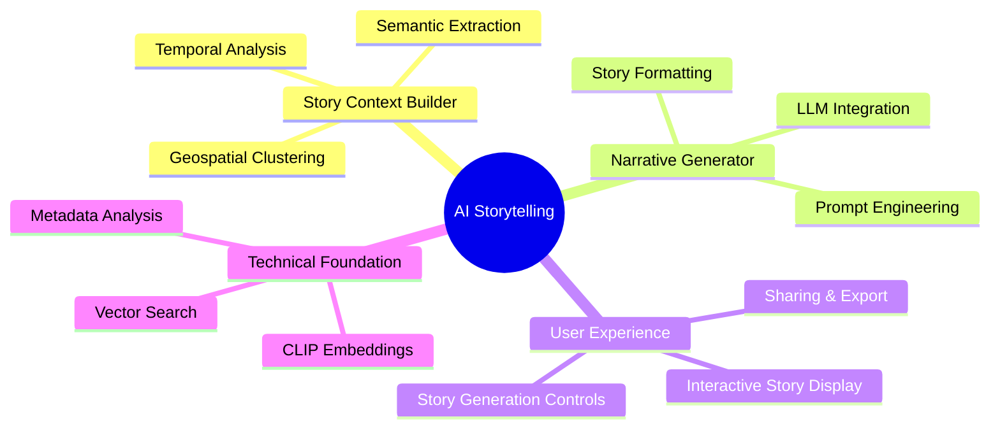

## 🎯 Integrated Roadmap (Innovation + Infrastructure)

### Phase 1: Foundation (Weeks 1-6) - **Innovation Readiness**

#### Week 1-2: Core Infrastructure for Storytelling
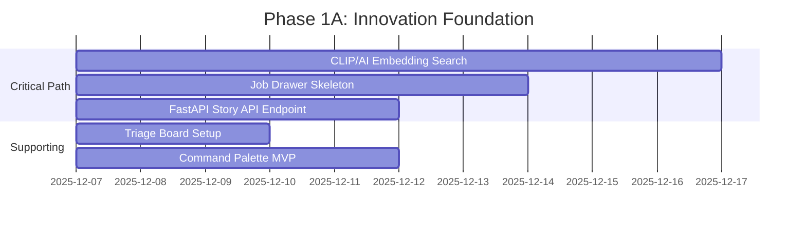

**Deliverables:**
- ✅ CLIP embedding search with storytelling optimization
- ✅ Job drawer with story generation status tracking
- ✅ FastAPI endpoints for story generation
- ✅ Project management infrastructure
- ✅ Basic command palette for navigation

#### Week 3-4: Storytelling MVP Components
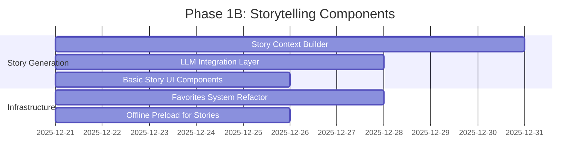

**Deliverables:**
- ✅ Story context analysis (temporal, spatial, semantic)
- ✅ LLM narrative generation integration
- ✅ Basic story display UI components
- ✅ Enhanced favorites system with story support
- ✅ Offline story access capability

#### Week 5-6: Integration & Testing
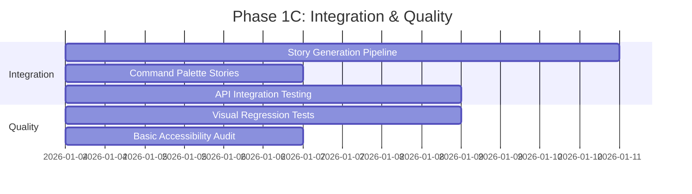

**Deliverables:**
- ✅ End-to-end story generation workflow
- ✅ Enhanced command palette with story commands
- ✅ Comprehensive API testing
- ✅ Visual regression test suite
- ✅ Basic accessibility compliance

### Phase 2: Growth (Weeks 7-12) - **Storytelling Launch**

#### Week 7-8: Advanced Storytelling Features
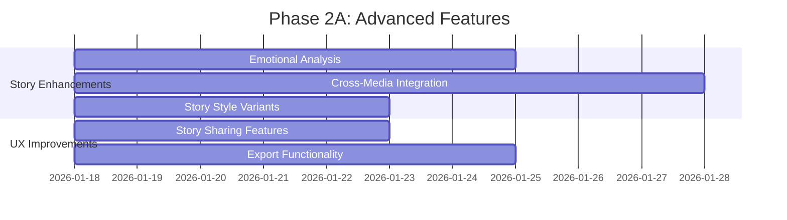

**Deliverables:**
- ✅ Emotional content analysis for stories
- ✅ Multimedia story support (photos + videos)
- ✅ Multiple story styles (museum, travelogue, etc.)
- ✅ Social sharing capabilities
- ✅ Story export (PDF, web)

#### Week 9-10: Monetization & Engagement


**Deliverables:**
- ✅ Premium story styles and templates
- ✅ Professional story book export
- ✅ Subscription monetization model
- ✅ Story engagement analytics
- ✅ User feedback collection system

#### Week 11-12: Polish & Launch Preparation
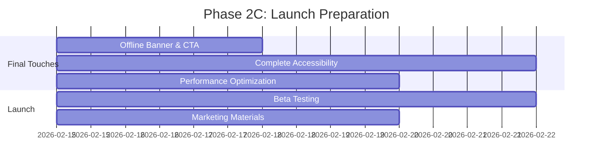

**Deliverables:**
- ✅ Polished offline/online UX
- ✅ Full accessibility compliance
- ✅ Performance-optimized storytelling
- ✅ Beta testing program
- ✅ Launch marketing materials

### Phase 3: Expansion (Weeks 13-24) - **Ecosystem Growth**

#### Week 13-16: Professional Tools
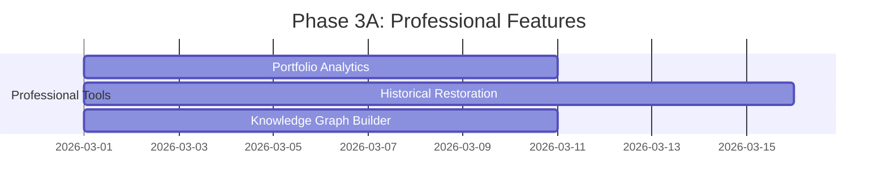

**Deliverables:**
- ✅ Professional portfolio analytics
- ✅ AI-powered photo restoration
- ✅ Semantic knowledge graphs

#### Week 17-20: Future Experiences
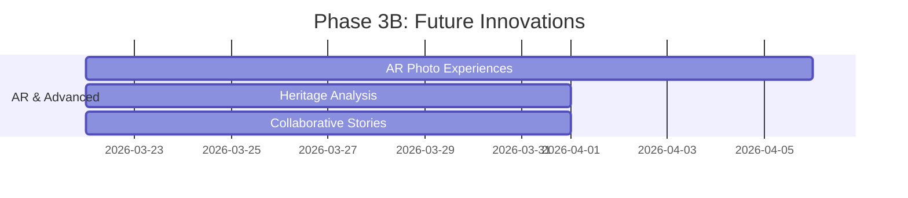

**Deliverables:**
- ✅ Augmented reality photo experiences
- ✅ Family heritage analysis
- ✅ Collaborative storytelling features

#### Week 21-24: Partnerships & Scaling
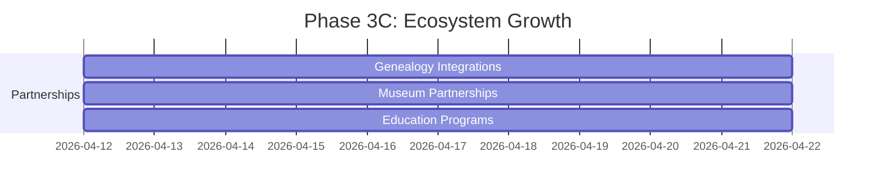

**Deliverables:**
- ✅ Genealogy platform integrations
- ✅ Museum partnership programs
- ✅ Educational institution collaborations

## 🎨 Updated Technical Architecture

### System Architecture with Storytelling Components
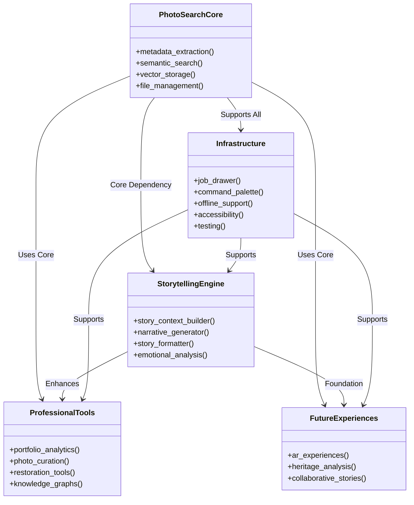

### Data Flow Architecture
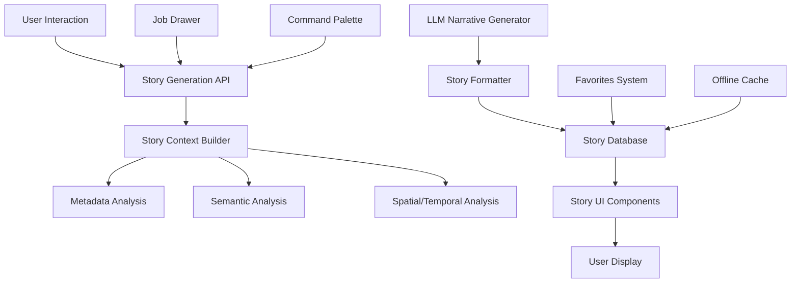

## 💰 Business Model Integration

### Monetization Timeline
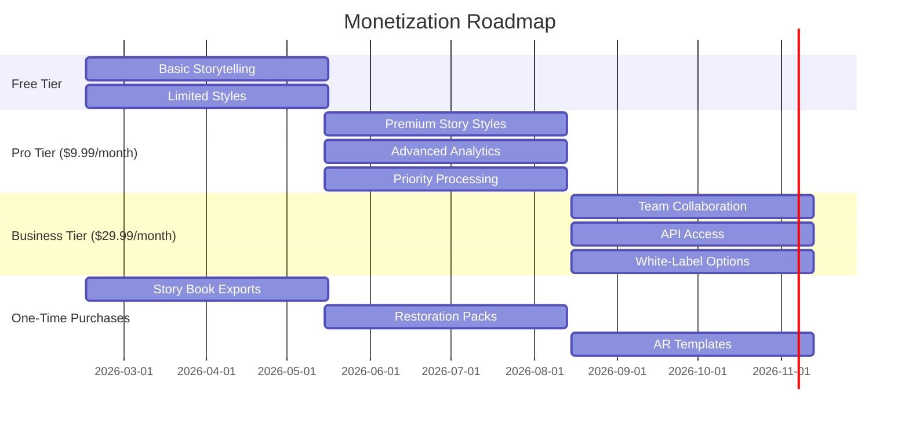

### Revenue Projections
| Quarter | Feature Set | Projected Revenue |
|---------|-------------|-------------------|
| Q1 2026 | Basic Storytelling (Free) | $0 (User Acquisition) |
| Q2 2026 | Premium Styles & Exports | $15K-$25K/month |
| Q3 2026 | Professional Tools | $40K-$60K/month |
| Q4 2026 | AR & Partnerships | $75K-$100K/month |
| Q1 2027 | Enterprise Features | $120K-$150K/month |

## 📈 Success Metrics & KPIs

### Innovation-Specific Metrics
```mermaid
graph TD
    A[Story Generation] --> B[60%+ of active users generate stories]
    A --> C[80%+ story completion rate]
    A --> D[Average 3 stories/user/month]
    
    E[User Engagement] --> F[+40% session duration]
    E --> G[+25% 30-day retention]
    E --> H[+35% DAU/MAU ratio]
    
    I[Monetization] --> J[5-8% premium conversion]
    I --> K[+30% ARPU increase]
    I --> L[$50K/year partnership revenue]
    
    M[Quality] --> N[<1% story generation failures]
    M --> O[<5s average story generation time]
    M --> P[95%+ accessibility compliance]
```

### Phase-Specific KPIs

**Phase 1 (Foundation):**
- ✅ CLIP embedding accuracy >90%
- ✅ Story generation success rate >95%
- ✅ API response time <500ms
- ✅ Job drawer reliability 100%

**Phase 2 (Growth):**
- ✅ 40%+ users try storytelling
- ✅ 20%+ users create ≥3 stories
- ✅ 5% premium conversion rate
- ✅ 90%+ story satisfaction rating

**Phase 3 (Expansion):**
- ✅ 60%+ active storytellers
- ✅ 10% business tier adoption
- ✅ $75K+ monthly revenue
- ✅ 2+ major partnerships

## 🎯 Resource Allocation

### Team Structure
```mermaid
organizationalChart
    CEO
    --> CTO
    --> Product Manager
    --> Frontend Team
        --> React Developer
        --> UI/UX Designer
        --> Accessibility Specialist
    --> Backend Team
        --> Python Developer
        --> AI/ML Engineer
        --> API Specialist
    --> QA Team
        --> Test Automation
        --> Manual Testing
        --> Performance Testing
```

### Effort Distribution
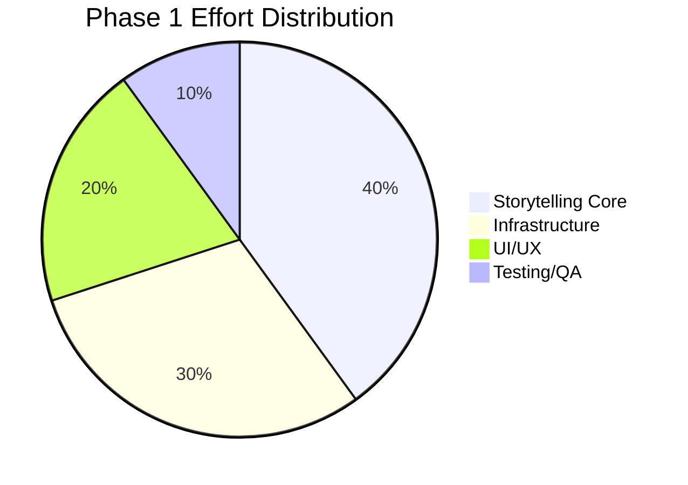

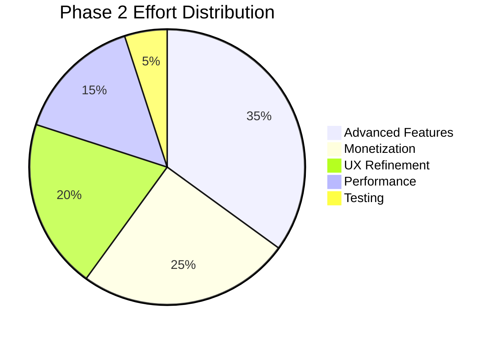

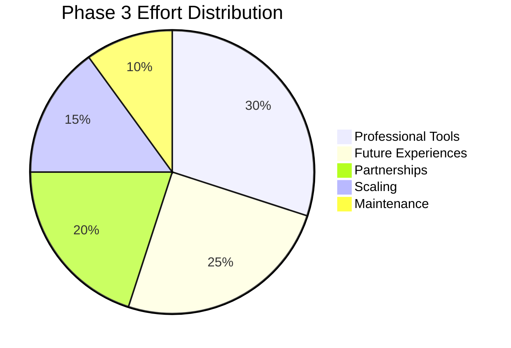

## 🚀 Risk Management

### Risk Assessment Matrix
| Risk | Impact | Likelihood | Mitigation Strategy |
|------|--------|------------|---------------------|
| LLM Integration Issues | High | Medium | Start with simple prompts, iterate |
| Story Quality Problems | High | Medium | Human review pipeline, quality metrics |
| Performance Bottlenecks | Medium | High | Load testing, optimization sprints |
| User Adoption Challenges | High | Medium | Onboarding tutorials, feature discovery |
| Monetization Resistance | Medium | Medium | Free trial period, clear value proposition |
| Technical Debt Accumulation | Medium | High | Regular refactoring sprints, code reviews |

### Contingency Plans
1. **LLM Fallback:** Use simpler templates if LLM unavailable
2. **Story Quality:** Implement user feedback loop for improvements
3. **Performance:** Add caching layers and optimize embeddings
4. **Adoption:** Gamification and guided tours
5. **Monetization:** Flexible pricing tiers and discounts
6. **Technical Debt:** Dedicated refactoring weeks

## 🎓 Implementation Guidelines

### Development Principles
1. **Incremental Delivery:** Release small, valuable features frequently
2. **User-Centric Design:** Prioritize user needs and feedback
3. **Quality First:** Maintain high standards for all components
4. **Performance Focus:** Optimize for speed and responsiveness
5. **Accessibility:** Ensure inclusive experiences for all users
6. **Extensibility:** Design for future growth and features

### Best Practices
- **Code Reviews:** Mandatory for all changes
- **Testing:** Comprehensive test coverage (unit, integration, e2e)
- **Documentation:** Complete docs for all components
- **Monitoring:** Comprehensive logging and error tracking
- **CI/CD:** Automated deployment pipeline
- **Feature Flags:** Safe rollout of new features

## 📝 Decision Log

### Key Architectural Decisions
1. **LLM Provider:** Start with Groq for cost/performance balance
2. **Story Storage:** Extend existing metadata database schema
3. **UI Framework:** Continue with React for flexibility
4. **Offline Support:** Service worker + IndexedDB caching
5. **API Design:** RESTful with GraphQL consideration for future

### Open Questions
1. **LLM Model Selection:** Need performance/quality tradeoff analysis
2. **Story Versioning:** How to handle story updates and revisions
3. **Collaboration Features:** Real-time vs. async collaboration models
4. **AR Implementation:** WebAR vs. native app integration
5. **Partnership Models:** Revenue share vs. licensing approaches

## 🎯 Next Steps

### Immediate Actions (Week 1)
- [ ] Finalize Phase 1 technical design
- [ ] Set up project management infrastructure
- [ ] Begin CLIP embedding optimization
- [ ] Start job drawer implementation
- [ ] Design story API endpoints

### Short-Term (Weeks 2-4)
- [ ] Complete storytelling MVP components
- [ ] Integrate with existing infrastructure
- [ ] Begin basic testing setup
- [ ] Gather initial user feedback

### Medium-Term (Weeks 5-12)
- [ ] Launch storytelling beta program
- [ ] Implement monetization features
- [ ] Optimize performance
- [ ] Prepare for public launch

### Long-Term (Weeks 13+)
- [ ] Expand professional toolset
- [ ] Develop future experiences
- [ ] Build partnership ecosystem
- [ ] Scale infrastructure

## 🚀 Conclusion

This **Comprehensive Innovation Plan** integrates:
1. **Breakthrough AI Storytelling** feature
2. **Critical infrastructure improvements**
3. **Strategic phased implementation**
4. **Business model integration**
5. **Quality and performance focus**

By following this plan, PhotoSearch will:
- **Transform** from photo management to storytelling platform
- **Differentiate** in the crowded photo app market
- **Monetize** through multiple revenue streams
- **Lead** in AI-powered photo experiences
- **Grow** into a sustainable ecosystem

**The opportunity is significant, the plan is comprehensive, and the timing is perfect.** With focused execution, PhotoSearch can become the **next generation of photo experiences** - where every collection tells a story.