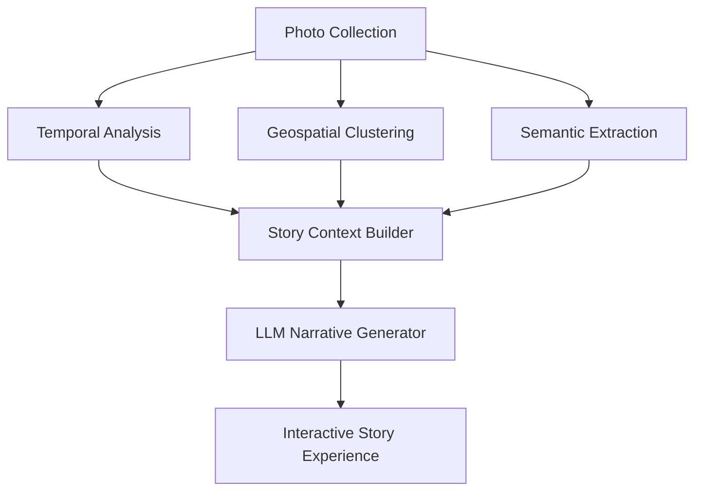

# 🎭 AI-Powered Storytelling: The Breakthrough Feature

**Status:** Conceptual Design  
**Status update:** (2025-12-13) Partial / In progress

> NOTE (2025-12-13): Story Mode UI exists in the frontend (`ui/src/components/StoryMode.tsx`, `ui/src/pages/StoryModePage.tsx`) and can display outlines and a narrative surface. However, the backend server endpoints and story-building pipeline referenced in this doc (e.g., `server/story_context.py`, `server/story_generator.py`, and `/api/story/*` endpoints) are proposed and not yet implemented in the current repository. The code samples below should be treated as implementation proposals rather than already-available services.
> **Priority:** High  
> **Potential Impact:** Game-changing differentiation

## 🚀 Executive Summary

This document outlines a revolutionary feature that leverages the existing photo search infrastructure to create **automated, context-aware narratives** from users' photo collections. This transforms the app from a simple search tool into a **personal storytelling platform** with museum-quality experiences.

## 💡 The Big Idea

### Current State

- Users have thousands of photos but struggle to organize them meaningfully
- Photo apps focus on storage, search, and basic organization
- No app creates **automatic narratives** that tell the story behind the photos

### The Opportunity

- Combine temporal, spatial, and semantic data to generate compelling stories
- Use AI to create **museum exhibit-style narratives** from personal photo collections
- Enable users to **relive memories** through curated storytelling experiences

## 🎯 Core Innovation

### Multi-Modal Story Generation

The system analyzes three dimensions of photo data:

1. **Temporal Patterns** (When)

   - Timeline analysis from EXIF timestamps
   - Event clustering (trips, holidays, life milestones)
   - Temporal relationships between photos

2. **Geospatial Context** (Where)

   - GPS metadata clustering into meaningful locations
   - Travel route reconstruction
   - Location-based storytelling

3. **Semantic Content** (What)
   - CLIP embedding analysis for visual themes
   - Object and scene detection
   - Emotional content analysis

### Story Generation Pipeline



## 🔧 Technical Implementation

### 1. Story Context Builder

**File:** `server/story_context.py`

```python
class StoryContextBuilder:
    def __init__(self, metadata_db, vector_store):
        self.db = metadata_db
        self.vector_store = vector_store

    def build_context(self, photo_ids):
        """Create comprehensive context for story generation"""
        context = {
            'temporal': self._analyze_timeline(photo_ids),
            'geospatial': self._analyze_locations(photo_ids),
            'semantic': self._analyze_content(photo_ids),
            'metadata': self._extract_key_metadata(photo_ids)
        }
        return context

    def _analyze_timeline(self, photo_ids):
        """Identify temporal patterns and events"""
        # Get all photos with timestamps
        # Cluster into events based on time proximity
        # Identify key moments and transitions

    def _analyze_locations(self, photo_ids):
        """Create geospatial narrative"""
        # Extract GPS data
        # Cluster locations (home, travel destinations)
        # Reconstruct travel routes
        # Identify location significance

    def _analyze_content(self, photo_ids):
        """Extract semantic themes using embeddings"""
        # Use vector search to find visual themes
        # Detect objects, scenes, and activities
        # Analyze emotional content
        # Identify recurring motifs
```

### 2. Narrative Generator

**File:** `server/story_generator.py`

```python
class StoryGenerator:
    def __init__(self):
        # Use Groq for fast, cost-effective LLM inference
        self.llm = LLMClient(provider="groq", model="mixtral-8x7b")

    def generate_story(self, context, style="museum_exhibit"):
        """Generate narrative from story context"""

        # Create structured prompt
        prompt = self._create_prompt(context, style)

        # Generate story using LLM
        story_text = self.llm.generate(prompt)

        # Post-process and structure
        return self._structure_story(story_text)

    def _create_prompt(self, context, style):
        """Create detailed prompt for LLM"""
        timeline = context['temporal']
        locations = context['geospatial']
        themes = context['semantic']
        metadata = context['metadata']

        if style == "museum_exhibit":
            return f"""
            You are a museum curator creating an exhibit narrative.

            Timeline: {timeline['summary']}
            Key Events: {timeline['events']}

            Locations: {locations['summary']}
            Travel Route: {locations['route']}

            Visual Themes: {themes['dominant']}
            Recurring Motifs: {themes['motifs']}

            Create a compelling museum exhibit narrative that:
            1. Introduces the collection with historical context
            2. Highlights key moments and their significance
            3. Connects locations to create a spatial narrative
            4. Identifies visual themes and their meaning
            5. Ends with a thoughtful conclusion

            Style: Engaging, educational, and emotionally resonant
            Tone: Professional yet accessible
            Length: 800-1200 words
            """
```

### 3. API Integration

**File:** `server/main.py` (additions)

```python
# Add to imports
# NOTE (2025-12-13): These server modules are suggested; not currently present in the repository. They are here as design guidance.
# from server.story_context import StoryContextBuilder
# from server.story_generator import StoryGenerator

# Add to startup
story_context_builder = None
story_generator = None

@app.on_event("startup")
async def startup_event():
    global story_context_builder, story_generator
    # ... existing code ...
    story_context_builder = StoryContextBuilder(photo_search_engine.db, vector_store)
    story_generator = StoryGenerator()

# New API Endpoints
class StoryRequest(BaseModel):
    photo_ids: List[str]
    style: str = "museum_exhibit"

@app.post("/story/generate")
async def generate_story(request: StoryRequest):
    """Generate story from specific photos"""
    try:
        # Build context
        context = story_context_builder.build_context(request.photo_ids)

        # Generate story
        story = story_generator.generate_story(context, request.style)

        return {
            "story": story,
            "context": context,  # For UI enhancements
            "metadata": {
                "photo_count": len(request.photo_ids),
                "generated_at": datetime.now().isoformat(),
                "style": request.style
            }
        }
    except Exception as e:
        raise HTTPException(status_code=500, detail=str(e))

@app.get("/story/auto")
async def auto_story(
    time_range: str = "month",
    theme: Optional[str] = None
):
    """Automatically generate story from recent photos"""
    try:
        # Get photos based on criteria
        if time_range == "month":
            photo_ids = photo_search_engine.get_recent_photos(days=30)
        elif time_range == "year":
            photo_ids = photo_search_engine.get_recent_photos(days=365)

        # Filter by theme if specified
        if theme:
            photo_ids = photo_search_engine.filter_by_theme(photo_ids, theme)

        if not photo_ids:
            return {"error": "No photos found for the specified criteria"}

        # Generate story
        context = story_context_builder.build_context(photo_ids)
        story = story_generator.generate_story(context)

        return {
            "story": story,
            "photo_ids": photo_ids,
            "time_range": time_range,
            "theme": theme
        }
    except Exception as e:
        raise HTTPException(status_code=500, detail=str(e))
```

### 4. UI Integration

**File:** `ui/src/components/StoryMode.tsx` (enhanced)

```tsx
import { useState, useEffect } from 'react';
import { motion } from 'framer-motion';
import { Book, Sparkles, Globe, Calendar, Tag } from 'lucide-react';

interface Story {
  title: string;
  narrative: string;
  sections: Array<{
    title: string;
    content: string;
    photoIds: string[];
  }>;
  metadata: {
    photoCount: number;
    generatedAt: string;
    style: string;
  };
}

export function StoryMode({ photos, onPhotoSelect }) {
  const [story, setStory] = useState<Story | null>(null);
  const [loading, setLoading] = useState(false);
  const [storyType, setStoryType] = useState<'auto' | 'custom'>('auto');
  const [timeRange, setTimeRange] = useState<'month' | 'year'>('month');
  const [selectedPhotoIds, setSelectedPhotoIds] = useState<string[]>([]);

  // Auto-generate story on mount
  useEffect(() => {
    if (storyType === 'auto') {
      generateAutoStory();
    }
  }, [storyType, timeRange]);

  const generateAutoStory = async () => {
    setLoading(true);
    try {
      const response = await fetch(`/api/story/auto?time_range=${timeRange}`);
      const data = await response.json();
      setStory(data.story);
      setSelectedPhotoIds(data.photo_ids);
    } catch (error) {
      console.error('Auto story generation failed:', error);
    } finally {
      setLoading(false);
    }
  };

  const generateCustomStory = async () => {
    if (selectedPhotoIds.length === 0) return;

    setLoading(true);
    try {
      const response = await fetch('/api/story/generate', {
        method: 'POST',
        headers: { 'Content-Type': 'application/json' },
        body: JSON.stringify({
          photo_ids: selectedPhotoIds,
          style: 'museum_exhibit',
        }),
      });
      const data = await response.json();
      setStory(data.story);
    } catch (error) {
      console.error('Custom story generation failed:', error);
    } finally {
      setLoading(false);
    }
  };

  const togglePhotoSelection = (photoId: string) => {
    setSelectedPhotoIds((prev) =>
      prev.includes(photoId)
        ? prev.filter((id) => id !== photoId)
        : [...prev, photoId]
    );
  };

  return (
    <div className='story-mode-container'>
      {/* Story Controls */}
      <div className='story-controls'>
        <div className='flex gap-2'>
          <button
            onClick={() => setStoryType('auto')}
            className={`px-3 py-1 rounded-full text-sm ${
              storyType === 'auto' ? 'bg-primary' : 'bg-secondary'
            }`}
          >
            <Sparkles size={14} className='inline mr-1' />
            Auto Story
          </button>
          <button
            onClick={() => setStoryType('custom')}
            className={`px-3 py-1 rounded-full text-sm ${
              storyType === 'custom' ? 'bg-primary' : 'bg-secondary'
            }`}
          >
            <Book size={14} className='inline mr-1' />
            Custom Story
          </button>
        </div>

        {storyType === 'auto' && (
          <div className='time-range-selector'>
            <button
              onClick={() => setTimeRange('month')}
              className={timeRange === 'month' ? 'active' : ''}
            >
              <Calendar size={14} className='inline mr-1' />
              Last Month
            </button>
            <button
              onClick={() => setTimeRange('year')}
              className={timeRange === 'year' ? 'active' : ''}
            >
              <Calendar size={14} className='inline mr-1' />
              Last Year
            </button>
          </div>
        )}

        {storyType === 'custom' && (
          <button
            onClick={generateCustomStory}
            disabled={loading || selectedPhotoIds.length === 0}
            className='generate-button'
          >
            {loading ? (
              <>
                Generating Story... <span className='loading-dots'>⠋</span>
              </>
            ) : (
              <>Create Story from {selectedPhotoIds.length} photos</>
            )}
          </button>
        )}
      </div>

      {/* Story Display */}
      {story ? (
        <motion.div
          initial={{ opacity: 0, y: 20 }}
          animate={{ opacity: 1, y: 0 }}
          className='story-display'
        >
          <div className='story-header'>
            <h2 className='story-title'>{story.title}</h2>
            <p className='story-meta'>
              {story.metadata.photoCount} photos • {story.metadata.generatedAt}
            </p>
          </div>

          <div className='story-content'>
            {story.sections.map((section, index) => (
              <div key={index} className='story-section'>
                <h3>{section.title}</h3>
                <p>{section.content}</p>

                {section.photoIds.length > 0 && (
                  <div className='section-photos'>
                    {section.photoIds.map((photoId) => {
                      const photo = photos.find((p) => p.id === photoId);
                      return (
                        photo && (
                           onPhotoSelect(photo)}
                            className={`photo-thumbnail ${
                              selectedPhotoIds.includes(photoId)
                                ? 'selected'
                                : ''
                            }`}
                            onClick={() => togglePhotoSelection(photoId)}
                          />
                        )
                      );
                    })}
                  </div>
                )}
              </div>
            ))}
          </div>

          {/* Story Actions */}
          <div className='story-actions'>
            <button className='share-button'>
              <Globe size={16} className='inline mr-1' />
              Share Story
            </button>
            <button className='export-button'>
              <Book size={16} className='inline mr-1' />
              Export as Book
            </button>
            <button
              className='regenerate-button'
              onClick={
                storyType === 'auto' ? generateAutoStory : generateCustomStory
              }
            >
              <Sparkles size={16} className='inline mr-1' />
              Regenerate
            </button>
          </div>
        </motion.div>
      ) : (
        <div className='story-placeholder'>
          {loading ? (
            <div className='loading-state'>
              <motion.div
                animate={{ rotate: 360 }}
                transition={{ duration: 2, repeat: Infinity, ease: 'linear' }}
              >
                <Sparkles size={32} />
              </motion.div>
              <p>Crafting your story...</p>
            </div>
          ) : (
            <div className='empty-state'>
              <Book size={48} className='text-muted-foreground' />
              <p>No story generated yet</p>
              <p className='text-sm text-muted-foreground'>
                {storyType === 'auto'
                  ? 'Select a time range to generate an automatic story'
                  : 'Select photos to create a custom story'}
              </p>
            </div>
          )}
        </div>
      )}
    </div>
  );
}
```

## 🎨 User Experience Flow

### 1. Automatic Story Generation

```
User opens app → Auto-story generates from recent photos → Beautiful narrative displayed
```

### 2. Custom Story Creation

```
User selects photos → Clicks "Create Story" → AI generates personalized narrative → User can edit/refine
```

### 3. Story Exploration

```
User reads story → Clicks on photos in narrative → Seamless transition to photo detail view
```

### 4. Story Sharing

```
User generates story → Clicks "Share" → Options for social media, email, or export
```

## 💰 Business Model Opportunities

### Premium Features

- **Advanced Story Styles** ($4.99/month)

  - Historical narrative
  - Travelogue format
  - Family history style
  - Professional portfolio

- **Story Books** ($9.99/book)

  - PDF export with professional layouts
  - Physical book printing integration
  - Custom cover design options

- **Museum Exhibits** ($19.99/exhibit)
  - Virtual museum creation
  - Interactive exhibit features
  - Audio guide integration
  - QR code generation for physical display

### Partnership Opportunities

- **Genealogy Platforms** - Integrate with Ancestry.com, MyHeritage
- **Travel Companies** - Create travel story templates
- **Museums** - Digital exhibit partnerships
- **Education** - Historical storytelling for schools

## 📈 Market Differentiation

| Feature                        | PhotoSearch with AI Storytelling | Competitors |
| ------------------------------ | -------------------------------- | ----------- |
| Basic Search                   | ✅                               | ✅          |
| Semantic Search                | ✅                               | ❌          |
| Timeline View                  | ✅                               | ✅          |
| Map View                       | ✅                               | ✅          |
| **Automatic Story Generation** | ✅                               | ❌          |
| **Context-Aware Narratives**   | ✅                               | ❌          |
| **Museum-Quality Exhibits**    | ✅                               | ❌          |
| **Emotional Storytelling**     | ✅                               | ❌          |
| **Historical Context**         | ✅                               | ❌          |

## 🎯 Implementation Roadmap

### Phase 1: MVP (2-3 weeks)

- [ ] Implement StoryContextBuilder
- [ ] Integrate LLM for basic narrative generation
- [ ] Create simple story templates
- [ ] Add basic API endpoints
- [ ] Implement UI story display
- [ ] Add auto-story generation

### Phase 2: Advanced Features (3-4 weeks)

- [ ] Enhance temporal analysis
- [ ] Implement geospatial clustering
- [ ] Add semantic theme detection
- [ ] Create multiple story styles
- [ ] Implement story sharing
- [ ] Add export functionality

### Phase 3: Polish & Monetization (2-3 weeks)

- [ ] Add premium story styles
- [ ] Implement book export
- [ ] Create museum exhibit features
- [ ] Add partnership integrations
- [ ] Implement monetization endpoints
- [ ] Add analytics for story engagement

## 🔮 Future Enhancements

### 1. Collaborative Storytelling

- Multiple users contribute to shared stories
- Family history collaboration features
- Real-time co-authoring

### 2. Audio Narratives

- Text-to-speech for story narration
- Background music integration
- Audio guide export

### 3. Video Story Compilation

- Automatic video creation from stories
- Ken Burns effect on photos
- Transition effects based on narrative

### 4. Augmented Reality Stories

- AR overlays for physical photo displays
- Interactive story elements
- Location-based story triggers

### 5. Historical Context Integration

- Wikipedia API for location history
- Historical event correlation
- Timeline context enhancement

## 📝 Technical Requirements

### Dependencies

- **LLM Provider**: Groq (fast, cost-effective) or OpenAI
- **Vector Search**: Existing LanceDB implementation
- **Metadata**: Existing extraction system
- **UI**: Framer Motion for animations

### Performance Considerations

- **Caching**: Cache generated stories to avoid re-computation
- **Batch Processing**: Process multiple story requests efficiently
- **Rate Limiting**: Manage LLM API costs
- **Progressive Loading**: Stream story generation for better UX

## 🎓 Success Metrics

### User Engagement

- **Story Generation Rate**: % of users who generate stories
- **Story Completion**: % of generated stories read to completion
- **Story Sharing**: % of stories shared socially
- **Session Duration**: Increase in average session time

### Business Impact

- **Premium Conversion**: % of users upgrading for advanced features
- **Revenue per User**: Increase from story-related features
- **Partnership Revenue**: Income from integrations
- **User Retention**: Improvement in 30/90-day retention

## 🚀 Conclusion

The AI-powered storytelling feature represents a **paradigm shift** in photo management. By transforming passive photo collections into **active, engaging narratives**, this feature creates emotional connections that drive user engagement, retention, and monetization.

The implementation leverages **existing infrastructure** while adding minimal new complexity. The result is a **differentiated product** that stands out in the crowded photo app market and creates genuine value for users seeking to preserve and share their memories in meaningful ways.

**Recommendation**: Prioritize this feature as the next major development initiative with high potential for market impact and user adoption.
