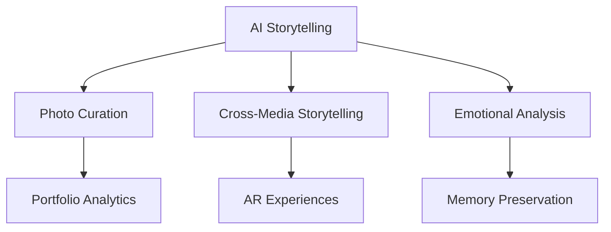

# 🌟 Innovation Opportunities in Photo Management

**Status:** Research & Brainstorming
**Date:** 2025-12-07
**Focus:** Identifying niche opportunities beyond the core AI storytelling feature

## 🔍 Market Research: Current Photo App Landscape

### Major Players & Their Focus

| App | Primary Focus | Missing Features |
|-----|---------------|------------------|
| **Google Photos** | Storage, basic search, AI organization | Advanced storytelling, semantic search, museum-quality experiences |
| **Apple Photos** | Integration with Apple ecosystem, Memories feature | Cross-platform, advanced AI, professional storytelling |
| **Amazon Photos** | Storage, Prime integration | AI features, search capabilities, storytelling |
| **Flickr** | Professional photography, communities | Modern AI, storytelling, advanced organization |
| **500px** | Professional portfolio, licensing | Personal storytelling, advanced search |

### Emerging Trends

1. **AI-Powered Organization** - Automatic tagging, object recognition
2. **Cross-Platform Access** - Web, mobile, desktop synchronization
3. **Privacy-Focused** - Local processing, end-to-end encryption
4. **Collaborative Features** - Shared albums, family collections
5. **Monetization** - Print services, premium features

## 💡 Niche Opportunity Analysis

### 1. **Professional Portfolio Analytics**
**Target:** Photographers, artists, creatives
**Opportunity:** Provide analytics and insights for professional portfolios

**Features:**
- Style consistency analysis
- Color palette extraction and recommendations
- Composition quality scoring
- Portfolio diversity metrics
- Client presentation tools

**Implementation:**
```python
# server/portfolio_analytics.py
class PortfolioAnalyzer:
    def analyze_style_consistency(self, photo_ids):
        """Analyze visual consistency across portfolio"""
        # Use embeddings to measure similarity
        # Provide style consistency score

    def extract_color_palettes(self, photo_ids):
        """Extract dominant color palettes"""
        # Use K-means clustering on color histograms
        # Provide palette recommendations

    def score_composition(self, photo_id):
        """Score photo composition using rule of thirds, etc."""
        # Implement composition analysis algorithms
```

### 2. **Historical Photo Restoration**
**Target:** Genealogy enthusiasts, archives, museums
**Opportunity:** AI-powered restoration of old/damaged photos

**Features:**
- Automatic scratch/tear removal
- Colorization of black & white photos
- Face enhancement and sharpening
- Historical context analysis
- Archive-quality preservation tools

**Implementation:**
```python
# server/photo_restoration.py
class PhotoRestorer:
    def restore_image(self, image_path):
        """Apply AI restoration techniques"""
        # Use stable diffusion or similar models
        # Integrate with Replicate API for restoration models

    def colorize_image(self, image_path):
        """Add realistic color to B&W photos"""
        # Use colorization models

    def enhance_faces(self, image_path):
        """Sharpen and enhance facial features"""
        # Use face enhancement models
```

### 3. **Photo-Based Knowledge Graph**
**Target:** Researchers, journalists, historians
**Opportunity:** Create semantic knowledge graphs from photo collections

**Features:**
- Entity extraction (people, places, objects)
- Relationship mapping
- Timeline visualization
- Knowledge graph export
- Research citation tools

**Implementation:**
```python
# server/knowledge_graph.py
class KnowledgeGraphBuilder:
    def build_graph(self, photo_collection):
        """Create knowledge graph from photos"""
        # Extract entities using NLP on captions/metadata
        # Build relationship graph
        # Visualize with D3.js or similar

    def export_graph(self, format='json'):
        """Export knowledge graph in various formats"""
        # Support JSON-LD, RDF, etc.
```

### 4. **AI-Powered Photo Curation**
**Target:** Busy professionals, social media managers
**Opportunity:** Automated selection of best photos for specific purposes

**Features:**
- Social media optimization (best photos for Instagram, LinkedIn, etc.)
- Event highlight selection
- Portfolio curation
- Automated album creation
- A/B testing for photo selection

**Implementation:**
```python
# server/photo_curation.py
class PhotoCurator:
    def select_best_for_social_media(self, photo_ids, platform='instagram'):
        """Select optimal photos for specific platforms"""
        # Analyze composition, subject, colors
        # Apply platform-specific criteria

    def create_event_highlights(self, event_photo_ids):
        """Automatically select highlight photos from events"""
        # Use diversity sampling
        # Ensure coverage of key moments
```

### 5. **Cross-Media Storytelling**
**Target:** Content creators, marketers, educators
**Opportunity:** Combine photos with other media types for rich storytelling

**Features:**
- Photo + video integration
- Audio narration synchronization
- Interactive story maps
- Multimedia timeline creation
- Export to various formats (video, web, PDF)

**Implementation:**
```python
# server/multimedia_story.py
class MultimediaStoryBuilder:
    def create_story(self, media_items):
        """Create story from mixed media types"""
        # Handle photos, videos, audio
        # Create cohesive narrative

    def generate_video_story(self, story_id):
        """Export story as video with transitions"""
        # Use FFmpeg for video compilation
        # Add Ken Burns effects
```

## 🎯 Additional Innovative Features

### 1. **Emotional Photo Analysis**
**Concept:** Analyze photos for emotional content and impact

**Implementation:**
```python
class EmotionAnalyzer:
    def analyze_emotional_content(self, photo_id):
        """Detect emotional impact of photos"""
        # Use facial expression analysis
        # Analyze color psychology
        # Detect compositional elements that evoke emotion

    def create_emotional_journey(self, photo_collection):
        """Map emotional progression through photo collection"""
        # Create timeline of emotional states
        # Identify emotional arcs
```

### 2. **Photo DNA & Heritage Analysis**
**Concept:** Analyze facial features across generations

**Implementation:**
```python
class HeritageAnalyzer:
    def analyze_facial_similarity(self, photo_ids):
        """Find facial similarities across photos"""
        # Use face recognition to find similar features
        # Create family resemblance maps

    def generate_heritage_report(self, family_photo_ids):
        """Create report on familial features"""
        # Analyze inherited traits
        # Generate visual comparisons
```

### 3. **Augmented Reality Photo Experiences**
**Concept:** Bring photos to life with AR overlays

**Implementation:**
```python
class ARExperienceBuilder:
    def create_ar_overlay(self, photo_id):
        """Generate AR content for photos"""
        # Create 3D reconstructions
        # Add interactive elements

    def generate_ar_timeline(self, photo_collection):
        """Create AR timeline experience"""
        # Spatial arrangement of photos
        # Interactive exploration
```

### 4. **Photo-Based Memory Preservation**
**Concept:** Help users preserve memories for future generations

**Implementation:**
```python
class MemoryPreserver:
    def create_memory_capsule(self, photo_collection):
        """Create digital time capsule"""
        # Package photos with context
        # Add historical background

    def generate_future_message(self, photos, message):
        """Create message to be opened in the future"""
        # Schedule delivery
        # Add contextual information
```

### 5. **Collaborative Photo Storytelling**
**Concept:** Multiple users contribute to shared photo narratives

**Implementation:**
```python
class CollaborativeStoryBuilder:
    def create_shared_story(self, contributor_ids):
        """Enable multiple users to contribute"""
        # Manage permissions
        # Merge contributions

    def resolve_conflicts(self, story_id):
        """Handle conflicting narratives"""
        # Provide resolution tools
        # Track changes
```

## 📊 Opportunity Evaluation Matrix

| Opportunity | Market Size | Technical Feasibility | Revenue Potential | Differentiation |
|------------|-------------|----------------------|-------------------|-----------------|
| AI Storytelling | Large | High | High | Very High |
| Portfolio Analytics | Medium | High | Medium | High |
| Historical Restoration | Medium | Medium | High | High |
| Knowledge Graph | Small | Medium | Medium | Very High |
| Photo Curation | Large | High | High | Medium |
| Cross-Media Storytelling | Medium | High | High | High |
| Emotional Analysis | Medium | Medium | Medium | High |
| Heritage Analysis | Small | Medium | Medium | Very High |
| AR Experiences | Large | Low | High | Very High |
| Memory Preservation | Medium | High | Medium | High |

## 🎯 Strategic Recommendations

### Short-Term (0-3 months)
1. **AI Storytelling** - Primary focus, highest impact
2. **Photo Curation** - Complements storytelling well
3. **Portfolio Analytics** - Appeals to professional users

### Medium-Term (3-6 months)
1. **Cross-Media Storytelling** - Expands storytelling capabilities
2. **Emotional Analysis** - Enhances storytelling depth
3. **Historical Restoration** - Niche but high-value market

### Long-Term (6-12 months)
1. **AR Experiences** - Future-proof innovation
2. **Knowledge Graph** - Research/education market
3. **Heritage Analysis** - Genealogy partnership potential

## 💡 Integration Synergies

### Storytelling Ecosystem


### Technical Synergies
- **Metadata Extraction** - Used by all features
- **Semantic Search** - Enables content understanding
- **Vector Embeddings** - Powers similarity analysis
- **LLM Integration** - Enables narrative generation
- **Timeline Analysis** - Foundation for temporal features

## 🚀 Implementation Priorities

### Phase 1: Core Storytelling (Current Focus)
- [x] AI Storytelling feature (documented)
- [ ] Basic photo curation tools
- [ ] Simple portfolio analytics

### Phase 2: Enhanced Storytelling
- [ ] Cross-media storytelling integration
- [ ] Emotional analysis features
- [ ] Advanced curation algorithms

### Phase 3: Professional Tools
- [ ] Full portfolio analytics suite
- [ ] Historical restoration tools
- [ ] Knowledge graph capabilities

### Phase 4: Future Experiences
- [ ] AR photo experiences
- [ ] Heritage analysis
- [ ] Memory preservation features

## 📈 Market Positioning Strategy

### Unique Value Proposition
"Transform your photo collection into living stories with AI-powered narratives, professional analytics, and immersive experiences that preserve memories and create emotional connections."

### Target Audience Segmentation

1. **Memory Keepers** (Primary)
   - Families preserving memories
   - Individuals documenting life journeys
   - Emotional storytelling focus

2. **Creative Professionals** (Secondary)
   - Photographers building portfolios
   - Artists creating visual narratives
   - Professional analytics and curation

3. **Researchers & Educators** (Tertiary)
   - Historians analyzing visual data
   - Educators creating learning materials
   - Knowledge graph capabilities

4. **Business Users** (Tertiary)
   - Marketers creating visual content
   - Social media managers
   - Brand storytelling tools

## 💰 Monetization Strategy

### Freemium Model
- **Free Tier**: Basic storytelling, limited curation
- **Pro Tier ($9.99/month)**: Advanced features, premium styles
- **Business Tier ($29.99/month)**: Team collaboration, analytics
- **Enterprise Tier (Custom)**: API access, white-label solutions

### Premium Features
- Advanced story styles and templates
- Professional portfolio analytics
- Historical restoration tools
- AR experience creation
- Priority processing and support

### One-Time Purchases
- Story book exports ($9.99/book)
- Historical restoration packs ($19.99/50 photos)
- AR experience templates ($4.99/template)

## 🎓 Conclusion

The photo management market presents **numerous niche opportunities** beyond the core AI storytelling feature. By strategically implementing a combination of:

1. **AI Storytelling** (Primary differentiator)
2. **Professional Tools** (Portfolio analytics, curation)
3. **Heritage Features** (Restoration, memory preservation)
4. **Future Experiences** (AR, knowledge graphs)

The application can establish a **unique market position** that appeals to both consumer and professional users while creating multiple revenue streams.

**Recommendation**: Begin with the AI storytelling feature as the foundation, then systematically add complementary features that leverage the existing technical infrastructure while expanding into adjacent market opportunities.
