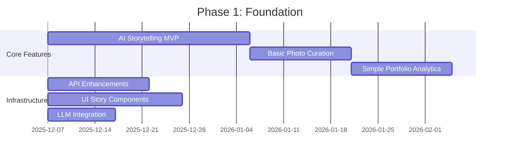
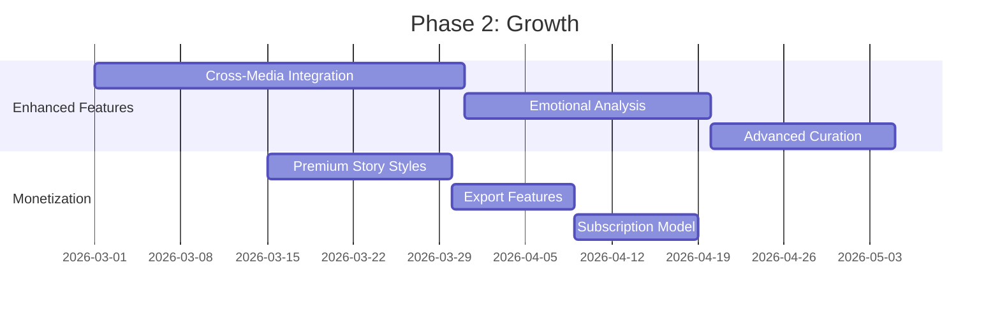
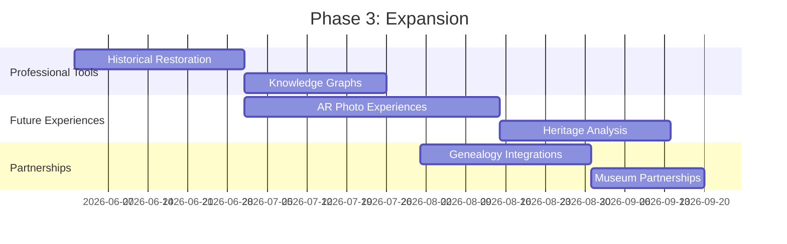
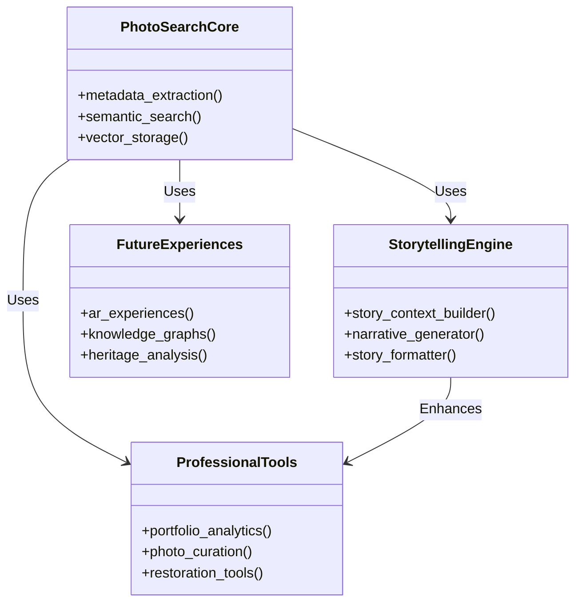

# 🎯 Innovation Strategy Summary

**Date:** 2025-12-07  
**Status:** Research Complete  
**Next Steps:** Implementation Planning

## 🚀 Executive Summary

This document summarizes the comprehensive innovation research conducted for the PhotoSearch application, identifying **breakthrough features** and **strategic opportunities** that can transform the product into a market leader.

## 💎 The Breakthrough Feature: AI-Powered Storytelling

### Core Innovation
**AI-Powered Storytelling** represents the single most impactful feature that leverages the existing infrastructure to create a **differentiated, emotionally engaging user experience**.

### Why It's Revolutionary
1. **Transforms passive collections into active narratives**
2. **Creates emotional connections with memories**
3. **Provides museum-quality storytelling experiences**
4. **Leverages existing technical infrastructure**
5. **Opens multiple monetization avenues**

### Key Components
- **Story Context Builder** - Analyzes temporal, spatial, and semantic data
- **Narrative Generator** - Uses LLM to create compelling stories
- **Interactive UI** - Beautiful story display and exploration
- **API Integration** - Seamless backend-frontend communication

### Implementation Timeline
- **Phase 1 (2-3 weeks):** MVP with basic storytelling
- **Phase 2 (3-4 weeks):** Advanced features and sharing
- **Phase 3 (2-3 weeks):** Monetization and polish

**Documentation:** See [`INNOVATION_AI_STORYTELLING.md`](INNOVATION_AI_STORYTELLING.md)

## 🌟 Additional Innovation Opportunities

### Short-Term Opportunities (0-3 months)
1. **Photo Curation** - Automated selection of best photos
2. **Portfolio Analytics** - Professional photography insights
3. **Basic Story Export** - Simple sharing and printing

### Medium-Term Opportunities (3-6 months)
1. **Cross-Media Storytelling** - Combine photos, videos, audio
2. **Emotional Analysis** - Detect and enhance emotional content
3. **Historical Restoration** - AI-powered photo enhancement

### Long-Term Opportunities (6-12 months)
1. **AR Experiences** - Augmented reality photo interactions
2. **Knowledge Graphs** - Semantic relationship mapping
3. **Heritage Analysis** - Family resemblance and DNA features

**Documentation:** See [`INNOVATION_OPPORTUNITIES.md`](INNOVATION_OPPORTUNITIES.md)

## 🎯 Strategic Roadmap

### Phase 1: Foundation (Current - 3 months)


### Phase 2: Growth (3-6 months)


### Phase 3: Expansion (6-12 months)


## 💰 Business Impact Analysis

### Revenue Projections
| Feature | Revenue Stream | Estimated Impact |
|---------|----------------|------------------|
| AI Storytelling | Premium subscriptions | High |
| Story Books | One-time exports | Medium-High |
| Portfolio Analytics | Professional tier | Medium |
| Historical Restoration | Premium packs | High |
| AR Experiences | Enterprise licenses | High |

### Market Differentiation
```
Current Market: Storage + Basic Search + Simple Organization
PhotoSearch:    Storage + Advanced Search + AI Storytelling + Professional Tools
```

### Competitive Advantage
- **First-to-market** with AI-powered storytelling
- **Superior user experience** with emotional engagement
- **Multiple revenue streams** from diverse features
- **Professional appeal** beyond consumer market

## 🎨 Technical Implementation Strategy

### Architecture Evolution


### Technology Stack Requirements
1. **LLM Integration** - Groq/OpenAI for narrative generation
2. **Vector Search** - Existing LanceDB (already implemented)
3. **Computer Vision** - CLIP embeddings, face detection
4. **UI/UX** - Framer Motion, responsive design
5. **API** - FastAPI enhancements for new endpoints

## 📈 Success Metrics

### User Engagement Metrics
- **Story Generation Rate**: Target 60% of active users
- **Story Completion**: Target 80% read-through rate
- **Session Duration**: Target +40% increase
- **Retention**: Target +25% improvement in 30-day retention

### Business Metrics
- **Conversion Rate**: Target 5-8% premium conversion
- **ARPU Increase**: Target +30% average revenue per user
- **Partnership Revenue**: Target $50K/year from integrations
- **Export Sales**: Target 10K exports/year at $9.99 each

## 🎯 Recommendations

### Immediate Actions (Next 2 Weeks)
1. **Finalize AI Storytelling MVP design**
2. **Create implementation plan with milestones**
3. **Allocate resources for development**
4. **Begin LLM integration testing**
5. **Design UI components for storytelling**

### Short-Term Priorities (Next 3 Months)
1. **Launch AI Storytelling MVP**
2. **Implement basic photo curation**
3. **Add portfolio analytics**
4. **Develop monetization strategy**
5. **Gather user feedback and iterate**

### Long-Term Vision (12 Months)
1. **Establish as market leader in AI photo storytelling**
2. **Expand into professional photography market**
3. **Develop partnership ecosystem**
4. **Create sustainable revenue streams**
5. **Continuous innovation pipeline**

## 🚀 Conclusion

The PhotoSearch application has **tremendous untapped potential** that can be unlocked through strategic innovation. The **AI-powered storytelling feature** represents a **game-changing opportunity** to differentiate in the crowded photo management market.

By implementing a **phased approach** that builds on the existing technical foundation while systematically adding complementary features, the application can:

1. **Create emotional connections** with users through storytelling
2. **Establish market leadership** in AI-powered photo experiences
3. **Generate multiple revenue streams** through diverse monetization
4. **Expand into adjacent markets** (professional, heritage, education)
5. **Build a sustainable innovation pipeline** for long-term growth

**Next Steps:**
1. Review the detailed innovation documents
2. Prioritize features based on business goals
3. Create implementation roadmap with timelines
4. Allocate development resources
5. Begin MVP development of AI storytelling feature

The opportunity is significant, the technical foundation is solid, and the market timing is perfect. With focused execution, PhotoSearch can become the **next generation of photo management** - transforming passive collections into living, breathing stories.