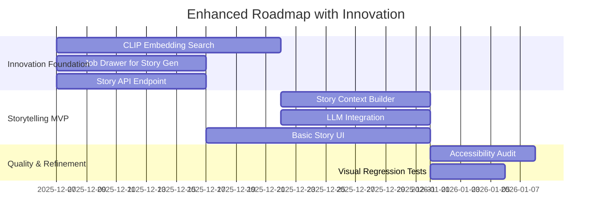
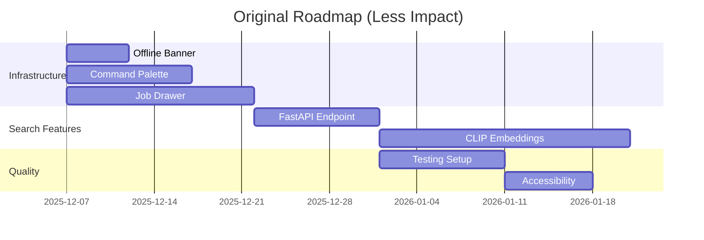

# 🎯 Critical Evaluation of Next Steps Proposal

**Date:** 2025-12-07  
**Context:** Evaluating proposed next steps against our innovation strategy  
**Focus:** Balancing immediate needs with long-term innovation goals

## 🔍 Evaluation Framework

### Criteria
1. **Strategic Alignment** - Does this support our AI storytelling vision?
2. **Innovation Impact** - Does this enable breakthrough features?
3. **Technical Synergy** - Does this leverage existing infrastructure?
4. **User Value** - Does this provide immediate user benefit?
5. **Implementation Complexity** - What's the effort vs. reward?

### Scoring System
- **🟢 High** - Strong alignment, high impact
- **🟡 Medium** - Some alignment, moderate impact
- **🔴 Low** - Minimal alignment, low impact

## 📋 Detailed Evaluation

### 1. Implement Offline Banner & Scan CTA
**Original Evaluation:** High impact, low complexity. Quick Win.

**Innovation Perspective:**
- **Strategic Alignment:** 🟡 Medium - Supports dual-mode but doesn't directly enable storytelling
- **Innovation Impact:** 🔴 Low - Infrastructure, not feature innovation
- **Technical Synergy:** 🟢 High - Uses existing scan capabilities
- **User Value:** 🟢 High - Clear UX improvement
- **Implementation Complexity:** 🟢 Low

**Recommendation:** ✅ **Proceed** - Foundational UX improvement that supports overall quality

### 2. Add Command Palette with Core Actions
**Original Evaluation:** Medium effort, high leverage. Quick Win.

**Innovation Perspective:**
- **Strategic Alignment:** 🟢 High - Enables power users to access storytelling features quickly
- **Innovation Impact:** 🟡 Medium - Could include "Generate Story" commands
- **Technical Synergy:** 🟢 High - Leverages existing action system
- **User Value:** 🟢 High - Improves workflow efficiency
- **Implementation Complexity:** 🟡 Medium

**Recommendation:** ✅ **Proceed with enhancement** - Add storytelling commands to palette

### 3. Build Job Drawer Skeleton (Background Tasks)
**Original Evaluation:** Medium complexity, essential for scaling. Quick Win.

**Innovation Perspective:**
- **Strategic Alignment:** 🟢 High - Critical for AI storytelling (story generation is async)
- **Innovation Impact:** 🟢 High - Enables background story generation
- **Technical Synergy:** 🟢 High - Supports all async operations
- **User Value:** 🟢 High - Better UX for long-running tasks
- **Implementation Complexity:** 🟡 Medium

**Recommendation:** ✅ **Prioritize** - Essential for AI storytelling feature

### 4. Integrate Manifest-Based Offline Preload
**Original Evaluation:** Medium effort, critical for reliability. Quick Win.

**Innovation Perspective:**
- **Strategic Alignment:** 🟡 Medium - Supports offline mode for storytelling
- **Innovation Impact:** 🔴 Low - Infrastructure, not feature innovation
- **Technical Synergy:** 🟢 Medium - Helps with asset management
- **User Value:** 🟡 Medium - Improves offline experience
- **Implementation Complexity:** 🟡 Medium

**Recommendation:** ✅ **Proceed** - Important for offline storytelling access

### 5. Refactor Favorites System for Persistence
**Original Evaluation:** Medium complexity. High user value.

**Innovation Perspective:**
- **Strategic Alignment:** 🟢 High - Users will want to favorite stories
- **Innovation Impact:** 🟡 Medium - Could extend to favorite story styles
- **Technical Synergy:** 🟢 High - Uses existing metadata system
- **User Value:** 🟢 High - Essential for user engagement
- **Implementation Complexity:** 🟡 Medium

**Recommendation:** ✅ **Proceed with storytelling extension** - Include story favoriting

### 6. Implement FastAPI Endpoint for Media Search
**Original Evaluation:** High impact, requires API design. P0.

**Innovation Perspective:**
- **Strategic Alignment:** 🟢 High - Foundation for story generation API
- **Innovation Impact:** 🟢 High - Enables semantic search for storytelling
- **Technical Synergy:** 🟢 High - Builds on existing search infrastructure
- **User Value:** 🟢 High - Better search = better story input
- **Implementation Complexity:** 🟡 Medium

**Recommendation:** ✅ **Prioritize** - Critical for AI storytelling backend

### 7. Add CLIP/AI Embedding Search for Images
**Original Evaluation:** High complexity, differentiates app. P0.

**Innovation Perspective:**
- **Strategic Alignment:** 🟢🟢🟢 **Very High** - Core technology for AI storytelling
- **Innovation Impact:** 🟢🟢🟢 **Very High** - Enables semantic understanding for narratives
- **Technical Synergy:** 🟢🟢🟢 **Very High** - Uses existing embedding infrastructure
- **User Value:** 🟢🟢🟢 **Very High** - Transformative search experience
- **Implementation Complexity:** 🔴 High

**Recommendation:** ✅ **Top Priority** - Foundational for AI storytelling feature

### 8. Set Up Visual Regression Testing (Playwright)
**Original Evaluation:** Medium effort, saves time long-term.

**Innovation Perspective:**
- **Strategic Alignment:** 🟡 Medium - Ensures quality for new features
- **Innovation Impact:** 🔴 Low - Testing infrastructure
- **Technical Synergy:** 🟢 Medium - Helps maintain all features
- **User Value:** 🟡 Medium - Indirect benefit through quality
- **Implementation Complexity:** 🟡 Medium

**Recommendation:** ✅ **Proceed** - Important for maintaining quality during innovation

### 9. Implement Accessibility Audit (Axe, ARIA)
**Original Evaluation:** Low effort, high value. P1.

**Innovation Perspective:**
- **Strategic Alignment:** 🟢 High - Storytelling should be accessible to all
- **Innovation Impact:** 🔴 Low - Compliance, not innovation
- **Technical Synergy:** 🟢 Medium - Applies to all UI including stories
- **User Value:** 🟢 High - Essential for inclusivity
- **Implementation Complexity:** 🟢 Low

**Recommendation:** ✅ **Proceed** - Critical for inclusive storytelling experiences

### 10. Create Triage Board & Convert Backlog to Issues
**Original Evaluation:** Low effort, high organizational value.

**Innovation Perspective:**
- **Strategic Alignment:** 🟢 High - Needed to manage innovation pipeline
- **Innovation Impact:** 🟡 Medium - Enables better planning
- **Technical Synergy:** 🟢 Medium - Helps organize all work
- **User Value:** 🔴 Low - Internal process
- **Implementation Complexity:** 🟢 Low

**Recommendation:** ✅ **Proceed** - Essential for managing innovation roadmap

## 🎯 Strategic Alignment Analysis

### Innovation-Critical Items
1. **CLIP/AI Embedding Search** - 🟢🟢🟢 Core technology for storytelling
2. **Job Drawer Skeleton** - 🟢🟢🟢 Essential for async story generation
3. **FastAPI Endpoint** - 🟢🟢🟢 Foundation for storytelling API

### Innovation-Supporting Items
4. **Command Palette** - 🟢🟢 Enables quick access to storytelling features
5. **Favorites System** - 🟢🟢 Supports story favoriting and engagement
6. **Offline Preload** - 🟢🟢 Ensures storytelling works offline

### Infrastructure/Quality Items
7. **Visual Regression Testing** - 🟢 Supports quality during innovation
8. **Accessibility Audit** - 🟢 Ensures inclusive storytelling
9. **Triage Board** - 🟢 Manages innovation pipeline
10. **Offline Banner** - 🟢 Improves UX for all features

## 🚀 Revised Priority Recommendations

### Immediate (Next 2 Weeks) - Innovation Foundation
1. **CLIP/AI Embedding Search** - Core storytelling technology
2. **Job Drawer Skeleton** - For async story generation
3. **FastAPI Endpoint** - Storytelling API foundation
4. **Triage Board** - To manage the innovation pipeline

### Short-Term (2-4 Weeks) - Innovation Enablers
5. **Command Palette with Story Commands** - Quick access to storytelling
6. **Favorites System with Story Support** - User engagement
7. **Offline Preload for Stories** - Offline capability
8. **Visual Regression Testing** - Quality assurance

### Ongoing (4+ Weeks) - Quality & Refinement
9. **Accessibility Audit** - Inclusive storytelling
10. **Offline Banner** - UX polish

## 💡 Innovation Integration Opportunities

### Enhancements to Proposed Steps
1. **Command Palette** - Add "Generate Story" and "My Stories" commands
2. **Job Drawer** - Include story generation status and progress
3. **Favorites System** - Extend to favorite stories and story styles
4. **FastAPI Endpoint** - Design to support storytelling API needs
5. **CLIP Embeddings** - Optimize for narrative generation use cases

### New Innovation-Specific Items to Add
1. **Story Generation API Endpoint** - `/api/story/generate`
2. **Story Context Builder** - Backend service for narrative analysis
3. **Story UI Components** - React components for story display
4. **LLM Integration Layer** - For narrative generation
5. **Story Persistence** - Database schema for stories

## 📈 Impact Assessment

### With Innovation Integration

### Without Innovation Integration

## 🎯 Final Recommendations

### ✅ Proceed with All Proposed Items
All 10 suggested items have value and should be implemented. However, **prioritize and enhance them with innovation integration** to maximize impact.

### 🚀 Innovation-First Prioritization
1. **CLIP/AI Embedding Search** - Foundational for storytelling
2. **Job Drawer Skeleton** - Critical for async story generation
3. **FastAPI Endpoint** - API foundation for storytelling
4. **Story Generation Components** - Add to roadmap
5. **Command Palette with Story Commands** - Enhanced version

### 💡 Integration Strategy
- **Enhance existing items** with storytelling capabilities
- **Add innovation-specific components** to the roadmap
- **Maintain quality infrastructure** for sustainable growth
- **Balance immediate needs** with long-term vision

### 📊 Expected Outcomes
- **3-6 months:** Basic AI storytelling capability
- **6-9 months:** Advanced storytelling features
- **9-12 months:** Complete innovation ecosystem
- **12+ months:** Market leadership in AI photo experiences

## 🎓 Conclusion

The proposed next steps are **sound and valuable**, but they should be **prioritized and enhanced** to support the AI storytelling innovation strategy. By integrating storytelling capabilities into the existing roadmap and adding innovation-specific components, we can:

1. **Accelerate time-to-market** for breakthrough features
2. **Maximize ROI** on development efforts
3. **Create competitive differentiation** sooner
4. **Build a sustainable innovation pipeline**

**Recommendation:** Adopt the enhanced prioritization that integrates innovation goals with the proposed infrastructure improvements for maximum impact.